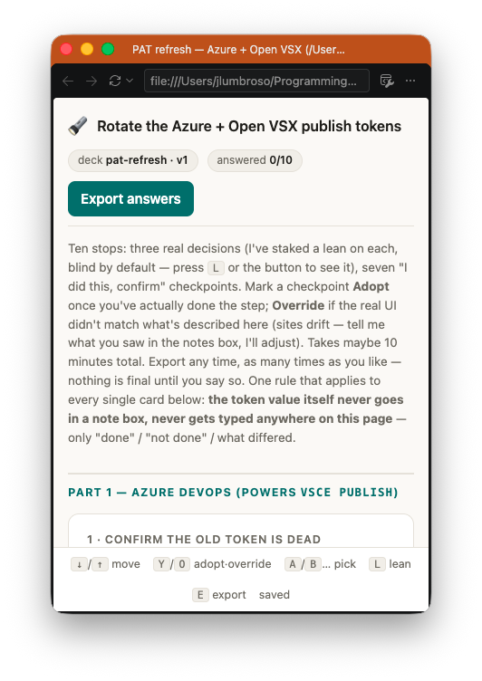
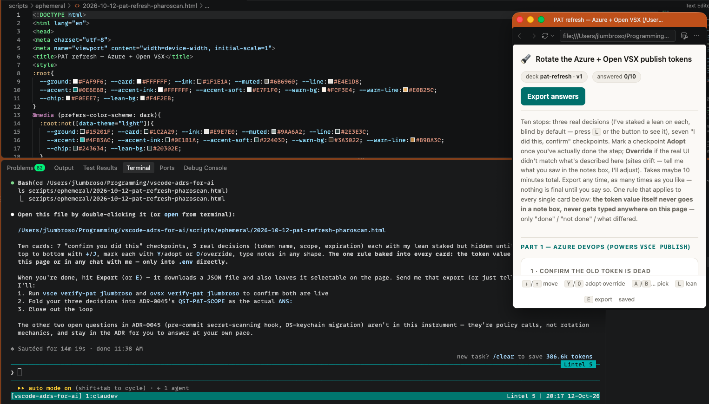
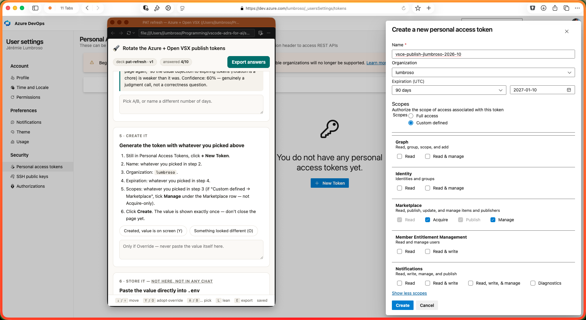
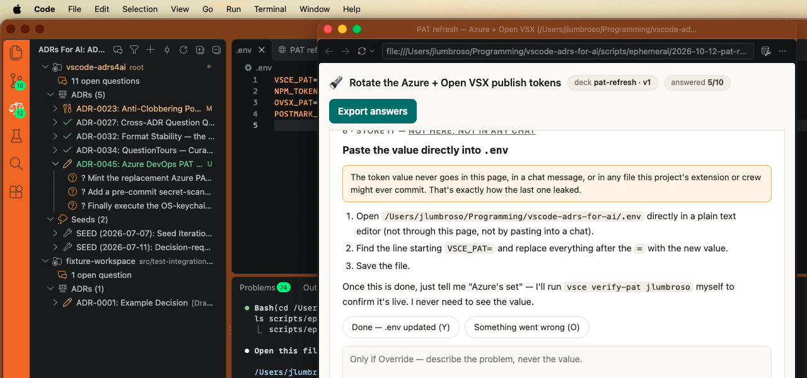
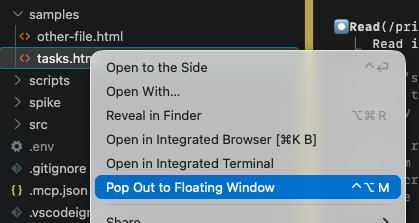
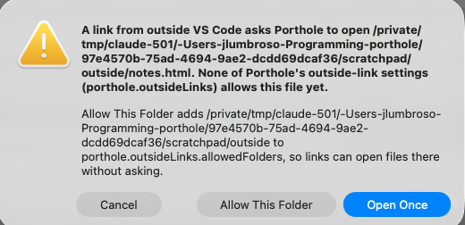

# Porthole

[](https://github.com/jlumbroso/porthole/actions/workflows/ci.yml)
[](https://github.com/jlumbroso/porthole/actions/workflows/ci.yml)
[](LICENSE)
[](https://marketplace.visualstudio.com/items?itemName=jlumbroso.porthole)
[](https://open-vsx.org/extension/jlumbroso/porthole)

Pop the HTML page or Markdown file you are looking at into a floating window in VS Code:
only the rendered page, pinned above your other windows.

If it is an HTML or Markdown file and you want it in view while you work (for instance, a
page of task instructions, a checklist, a design mock-up or a local report), porthole puts
it in a window of its own instead of an editor tab that disappears behind whatever you
open next.

## See it

The first real use, on 2026-10-12: a page of step-by-step instructions (for replacing the
publishing tokens of another project) kept in view while the person following it works in
other windows. Nothing was staged.



*The window alone: just the rendered page.*



*Beside the place the instructions came from.*



*Beside a different application: the steps stay in front while the person works in a web form.*



*And on to the next tool, without the page ever being moved.*

## What it does

1. **Pops a page out.** One gesture turns an HTML or Markdown file into a floating window
   showing only the rendered page: no tabs, breadcrumbs or status bar.
2. **Keeps it on top.** The window stays pinned above your other windows. Toggle that off
   and on whenever you like.
3. **Puts it back.** The same shortcut docks the page into your main window again.
4. **Resizes by preset.** Step through your own list of sizes (three by default).
5. **Stays live.** The page reloads when the file changes (VS Code's own auto-reload),
   and an HTML page's checkboxes, buttons and stored state keep working. A Markdown file
   is shown as VS Code's own Markdown preview, which updates as you edit the file; it is
   read-only (task-list boxes are shown, not clickable).

## Using it

| To do this | Do this |
| --- | --- |
| Pop an HTML or Markdown file out | `Ctrl+Alt+M` (`⌃⌥M` on macOS) with the file open, the window icon in the editor's title bar, right-click the file's tab, or right-click the file in the Explorer → **Pop Out to Floating Window** |
| Put it back | `Ctrl+Alt+M` again, with the floating window focused, or **Porthole: Dock Back into Main Window** |
| Change its size | **Porthole: Cycle Window Size** with the floating window focused |
| Unpin or re-pin it | **Porthole: Toggle Always on Top** |



*Right-click an HTML or Markdown file in the Explorer.*

Settings live under `porthole.*`: the size presets (`porthole.sizes`; the first preset is
the size a new window opens at), where the window opens (`porthole.position`), and whether
it opens compact and always on top (`porthole.compact`, `porthole.alwaysOnTop`).

**Light or dark Markdown.** `porthole.markdown.colorScheme` shows Markdown in porthole's
floating windows with `light` or `dark` colors whatever VS Code's theme, or `auto` to follow
it (the default). The colors follow the file: while a file is popped out, every preview of
it shows these colors; previews of other files keep following VS Code's theme. Code blocks
keep VS Code's syntax colors.

**One tab per floating window, with your consent.** Left alone, VS Code lets a second file
land as an extra tab in a floating window. At your first pop-out of each session, porthole
asks once whether VS Code may keep floating windows to one tab, by turning on its own
`workbench.editor.autoLockGroups` setting for the integrated browser and the Markdown
preview (buttons: **Keep Compact**, **Not Now**, **Don't Ask Again**; the last sets
`porthole.askToKeepCompact` to `false`). It writes only those two entries, never a copy of
VS Code's defaults, and tells you each time it changes a setting, with a button that opens
it. **Porthole: Review and Reset Settings…** lists every user setting set by or for
porthole, so you can remove the ones you pick.

**Other extensions' tabs.** Some extensions open a file by column number (for instance "column
two"), which can land in a floating window and bring its tab bar back. By default porthole
moves such a tab to the main window, keeping its cursor; `porthole.keepToOneTab` can instead
`ask` or leave it (`off`). A tab with unsaved changes is always left where it is.

**Pop Out twice.** Popping out a file that is already in a floating window brings that window
forward, where it is; it does not open a second one.

## Control from outside VS Code (experimental)

A terminal, a script or a coding agent can open a page in a floating window with one link, so
you do not have to find the file and press the shortcut yourself. **This is experimental**: it
has been run on macOS in VS Code only, `open` is the only verb, and the link's shape may still
change. The changelog says when it does.

```
vscode://jlumbroso.porthole/v1/open?file=/abs/path/tasks.html&width=420&height=640
```

| Parameter | Meaning |
| --- | --- |
| `file` (required) | An absolute path, or one relative to a workspace folder of the VS Code window that receives the link. |
| `width`, `height` | Both or neither, in pixels. Without them the window opens at your first size preset. |
| `repo` | A workspace folder's name, only to say which one a relative path belongs to. |

On macOS, `open '<link>'` in a terminal sends it (quote it, so the shell leaves `&` alone). The
window that receives it is the VS Code window you used last. Porthole's code opens no network port or
server: the link goes through VS Code's own link handling. The page must be a local `.html`, `.htm`, `.md` or
`.markdown` file; web addresses are not supported.

**What opens without asking is yours to decide**, with five settings:

| Setting | Default | Effect |
| --- | --- | --- |
| `porthole.outsideLinks.enabled` | on | Links are accepted at all. |
| `porthole.outsideLinks.actions.open` | on | Links may open pages. |
| `porthole.outsideLinks.allowWorkspaceFolders` | on | Files inside the receiving window's workspace folders open without asking. |
| `porthole.outsideLinks.allowedFolders` | none | More folders, by absolute path, whose files open without asking. |
| `porthole.outsideLinks.allowLocalFiles` | off | Any other local file opens without asking. |

Paths are compared after resolving `..`, symbolic links and letter case, so a path that only
looks inside an allowed folder does not pass. For a file no setting covers, porthole asks:



**Open Once** opens that page this time only. **Allow This Folder** adds the folder to
`porthole.outsideLinks.allowedFolders`. **Cancel** opens nothing.

**VS Code asks too, once.** The first time a link addresses an extension, VS Code shows its own
dialog, "Allow 'Porthole' extension to open this URI?", with a box "Do not ask me again for this
extension" (read in VS Code's source; it shows the address cut to its first 30 and last 5
characters). If you tick the box, porthole's settings above are the only check left, so set them
as you want before you do.

**What a link does to your screen.** A new floating window takes the keyboard (on macOS), so a
link sent while you type elsewhere sends your keystrokes into the page. Sending the same link
again brings the existing window forward; with a size, it reopens the page at that size. Editing
the file is how an agent updates a page: the window follows the file.

When a link is refused (a setting is off, the file does not exist, a relative path matches two
folders), porthole says why in a message and in the "Porthole" output channel. Turning
`porthole.outsideLinks.enabled` off turns all of this off. A [skill for models](.claude/skills/porthole/SKILL.md)
describes the same link in the terms an agent needs.

## Install

**From the Marketplace**: search for "Porthole" in VS Code's Extensions view, or run

```
code --install-extension jlumbroso.porthole
```

**From Open VSX**, for VS Code-compatible editors that use it ([open-vsx.org/extension/jlumbroso/porthole](https://open-vsx.org/extension/jlumbroso/porthole)).
It is published there, but porthole has only been run in VS Code itself, and the internal
command it relies on is VS Code's.

**From a release file**: each [GitHub release](https://github.com/jlumbroso/porthole/releases)
carries the exact `.vsix` that was published. Install it with
`code --install-extension porthole-<version>.vsix`.

**From source**: clone this repository, then run `just install-local` and reload the VS Code
window. (That builds the extension, packages it, installs the exact file, and prints what to
do next. It needs [`just`](https://just.systems) and Node 22.)

## Requirements

- VS Code desktop **1.134.0 or later**. That is the first release whose integrated browser
  opens local HTML files, as read in VS Code's source. porthole has been **run** on 1.134.0
  and on 1.141.0; the versions in between were read in VS Code's source but not run
  ([details](docs/release/VERSION-FLOOR.md)).
- Local HTML files (`.html`, `.htm`) and Markdown files (`.md`, `.markdown`). Remote and
  virtual workspaces are out of scope.
- Markdown uses VS Code's own preview. It was checked by hand on 1.141.0 only. Its preview
  editor is registered in VS Code's source from 1.134.0 (read, not run).
- **macOS, so far.** porthole has been run on macOS only. Windows and Linux are untested: the
  unit tests run on Linux in CI against a mocked VS Code, which says nothing about how the windows
  behave there.
- It leans on an internal VS Code command; see
  [what could break](#how-it-works-and-what-could-break).

**Support.** The latest VS Code release is the one officially supported. If you report a
problem on an older version, the first answer will be "can you update to the latest version?".

## How it works, and what could break

porthole renders nothing itself. VS Code already has an integrated browser, floating
windows, a compact mode with no tabs or status bar, and always-on-top. What was missing
is a single gesture that combines them at a chosen size.

**That gesture is an internal VS Code command, not a documented API.** porthole calls
`_workbench.openWith`, which opens a file in the integrated browser, in a new floating
window, already sized, compact and pinned. VS Code can change or remove it in any update,
without notice.

If that call throws or opens no window, porthole falls back to public commands that do
the same thing: the window still opens, compact and pinned, but at VS Code's own default
size rather than your first preset. The output channel "Porthole" says when the fallback
ran. The setting `porthole.useInternalCommand` turns the internal call off if you would
rather never use it.

What has been checked, so you can weigh it:

- The internal call was traced through VS Code's source, checked independently against
  that source, and then run: on VS Code 1.141.0 it opened the window in five runs out of
  five ([ADR-0003](docs/adr/0003-spike-0-does-the-one-shot-call-hold.md)), and in the 15 pop-outs
  of its first hands-on test it never needed the fallback
  ([ADR-0010](docs/adr/0010-first-hands-on-test-of-porthole-0-1-0.md)).
- Each new VS Code release is a release question. The check to re-run is kept in
  [`spike/`](spike/); until it is re-run on a version, that version is not claimed.

One thing to expect: the floating window keeps its title bar and the integrated browser's own
toolbar. "Only the rendered page" means no tabs, breadcrumbs or status bar.

**Known limits, both VS Code's rather than porthole's** (traced in VS Code's source,
[ADR-0010](docs/adr/0010-first-hands-on-test-of-porthole-0-1-0.md), QST-PASTE):

- **Cmd+V does not paste into a page in the floating window** on macOS: VS Code disables its
  Edit menu while a floating window has focus. Right-click → **Paste** works.
- **Ctrl+A and Ctrl+E** (start and end of line) do nothing in a page's text field, in any
  integrated-browser tab.

## Not here yet

- Popping out a page that is already open in a browser tab (today it starts from the file).
- More from outside VS Code than `open`: listing, refreshing, resizing, pinning, docking and
  closing windows (designed, not built), and web addresses.

## Try the idea today, with no extension

1. Open an HTML file in the integrated browser.
2. Right-click its tab and choose **Move into New Window**.
3. In the new window's title bar, click the compact icon and the pin icon.

This gives you the experience porthole aims for, minus the one-gesture part and the exact size.

## The name

A porthole is a small, fixed window you look *through*; nothing lives in it. That is the
object this builds: the floating window is the porthole. The pages it shows are often
served on localhost ports, which makes the pun honest.

## Changes, reports and contributing

- What changed in each version: [`CHANGELOG.md`](CHANGELOG.md), also the notes of each
  [GitHub release](https://github.com/jlumbroso/porthole/releases).
- A bug or an idea: [open an issue](https://github.com/jlumbroso/porthole/issues/new/choose).
  The bug form asks for your VS Code version and the "Porthole" output channel, which are
  the two facts that matter most here.
- Working on it: `npm ci`, then `npm run check` (typecheck, tests, bundle, and a check that
  the package ships exactly its six allowed files); `just gate` runs that plus the
  repository's own checks. Press F5 and choose **Run Porthole** to try a change in a
  second VS Code window.

## How this is built

This project is built by a human and AI collaborators working through written records, so
decisions survive from one session to the next. The whole record is in the repository:
the decisions in [`docs/adr/`](docs/adr/), the briefs the collaborators sent each other in
[`docs/inbox/`](docs/inbox/), the screenshots from the first test under
[`docs/adr/attachments/`](docs/adr/attachments/).

| To do this | Use |
| --- | --- |
| Check the repo before committing | `just gate` |
| Try the extension without installing it | press F5, **Run Porthole** |
| Install it into your VS Code | `just install-local`, then reload the window |
| Record a decision or open a question | `just adr "<title>"` |
| See every recipe | `just` |

- [`CLAUDE.md`](CLAUDE.md) holds the working agreements and the current focus.
- [`docs/inbox/ONBOARDING.md`](docs/inbox/ONBOARDING.md) is where a new collaborator starts.
- The research that started it is [`docs/INITIAL-DESIGN-BRIEF.md`](docs/INITIAL-DESIGN-BRIEF.md).

## Credits and lineage

- Research brief: Claude Opus 5.5, from a prompt by Jérémie Lumbroso. The
  outside-VS-Code trigger was that session's own idea; the prompt did not ask for it.
- Built by Jérémie Lumbroso with Glazier 5.5 (Claude Opus 5.5); claims checked against
  VS Code's source by Surveyor 5.1 (Claude Fable 5.1); the release prepared by Purser 5.5
  (Claude Sonnet 5.5). The full roster is in
  [`docs/inbox/agent-sessions.json`](docs/inbox/agent-sessions.json).
- The repo's structure comes from the
  [ADRs4AI human-AI collaboration template](https://github.com/ADRs4AI/human-ai-collaboration-template-A).
  What was unclear while adopting it is recorded in
  [`docs/TEMPLATE-FEEDBACK.md`](docs/TEMPLATE-FEEDBACK.md).

## License

[MIT](LICENSE).
